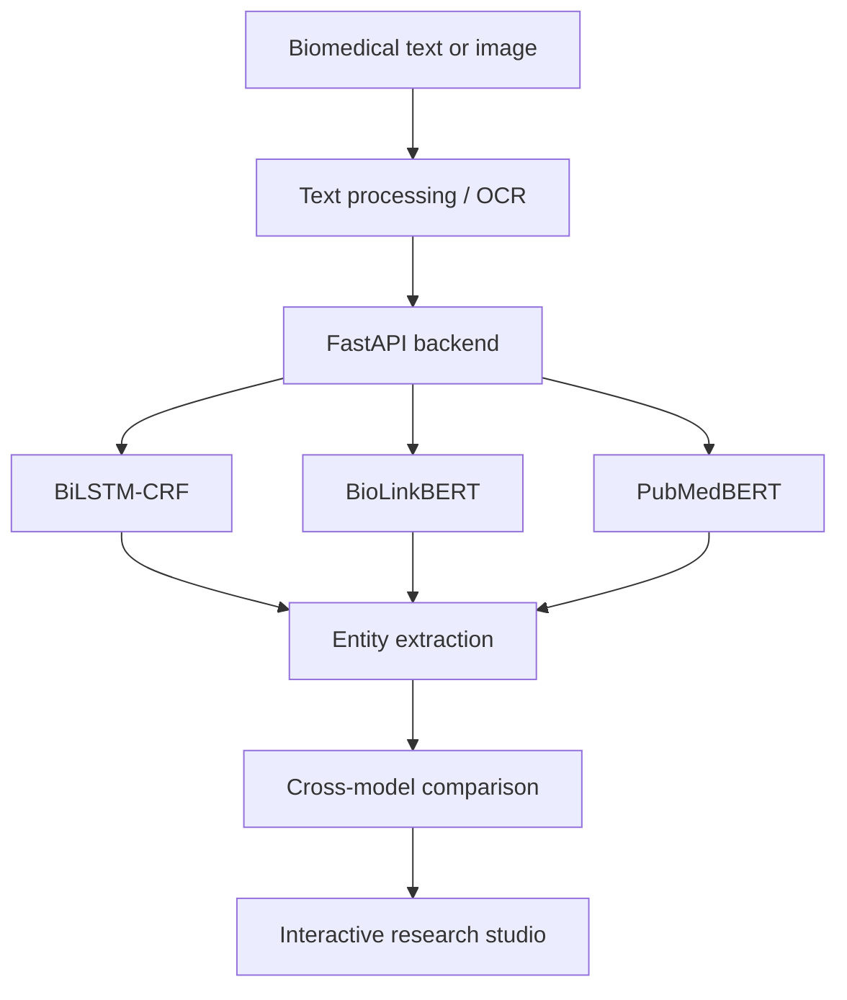

# 🧬 NeuroMed AI — Ultimate Research Studio

**An interactive biomedical intelligence platform powered by Deep Learning and Natural Language Processing.**


## 🌐 Project Overview

NeuroMed AI extracts, visualizes and compares biomedical entities from unstructured text. It combines three neural architectures with an immersive research interface, bridging biomedical NLP research and modern software engineering.

## 🎯 Objectives

- Identify chemical and disease entities in biomedical documents.
- Compare recurrent neural networks with biomedical Transformers.
- Explore model predictions through interactive visualizations.
- Transform unstructured text into structured information.

## ✨ Key Features

| Feature | Description |
|---|---|
| Biomedical NER | Chemical and disease entity extraction |
| Multi-model analysis | BiLSTM-CRF, BioLinkBERT and PubMedBERT |
| Interactive 3D visualizations | Rotatable and zoomable scientific illustrations |
| Spatial Entity Atlas | Interactive exploration of detected entities |
| Architecture Lab | Educational visualization of NLP pipelines |
| Agreement Matrix | Cross-model Jaccard similarity |
| OCR | Printed and handwritten text extraction |
| Research Analytics | Dynamic charts and entity distributions |
| Entity Inventory | Searchable and filterable entity tables |
| Data Export | CSV and JSON |
| Adaptive Interface | Responsive light and dark themes |

## 🧠 Deep Learning Architectures

- **BiLSTM-CRF:** Word embeddings, bidirectional contextual learning, structured BIO sequence labeling and Viterbi decoding.
- **BioLinkBERT:** Biomedical Transformer for contextual token classification.
- **PubMedBERT:** Domain-specific language model pretrained on biomedical literature and adapted to NER.

## 📚 Dataset — BC5CDR

The project focuses on biomedical NER using the BioCreative V Chemical Disease Relation dataset.

| BIO label | Meaning |
|---|---|
| B-Chemical | Beginning of a chemical entity |
| I-Chemical | Continuation of a chemical entity |
| B-Disease | Beginning of a disease entity |
| I-Disease | Continuation of a disease entity |
| O | Outside an entity |

## ⚙️ System Architecture



## 🔬 Research Workspace

- **Overview:** Immersive introduction to biomedical intelligence.
- **Analysis Studio:** Text input and OCR processing.
- **Entity Explorer:** Interactive annotations and spatial exploration.
- **Model Analytics:** Comparative analysis of neural predictions.
- **Architecture Lab:** Educational exploration of NLP architectures.
- **Data Inventory:** Structured entity management and export.

## 🛠️ Technology Stack

| Layer | Technologies |
|---|---|
| Programming | Python, JavaScript |
| Deep Learning | PyTorch |
| NLP | Hugging Face Transformers |
| Backend | FastAPI, Uvicorn |
| Frontend | HTML5, CSS3, JavaScript |
| Visualization | Canvas, SVG, 3D projections |
| OCR | Tesseract.js, Microsoft TrOCR |

## 📂 Project Structure

```text
neuromed-ai/
├── app.py
├── index.html
├── README.md
├── requirements.txt (if provided)
└── Model artifacts (not yet published)
    ├── word2idx.pkl
    ├── tag2idx.pkl
    ├── idx2tag.pkl
    ├── model.pth
    ├── biolinkbert_model.pkl
    └── pubmedbert_model.pkl
```

## 🚀 Getting Started

```bash
git clone https://github.com/ABDELARAHMENE-TABOUCHI/neuromed-ai.git
cd neuromed-ai
```

Install the dependencies from `requirements.txt` if provided. Place the original trusted model artifacts in the project root before starting the backend:

```bash
python app.py
```

- Application: http://127.0.0.1:8000
- API documentation: http://127.0.0.1:8000/docs

## 📸 Application Preview

Screenshots and an interactive demonstration are planned for a future update.

## 📦 Model Availability

The trained model artifacts are not currently included due to their size. The source code and frontend are available for exploration, but the complete inference pipeline requires the original trained model files. External model hosting is planned for a future release.

## 🔮 Future Roadmap

- [ ] Publish trained model artifacts.
- [ ] Deploy a public interactive demonstration.
- [ ] Publish detailed evaluation metrics.
- [ ] Extend biomedical entity categories and document processing.
- [ ] Explore biomedical relation extraction.
- [ ] Optimize inference performance.

## ⚠️ Research Disclaimer

NeuroMed AI is an educational and research-oriented project. Its predictions are not clinically validated and must not be used for medical diagnosis or treatment decisions. Architecture visualizations are educational representations. Cross-model agreement does not establish prediction accuracy or medical relationships.

## 👨‍💻 Author

**Abdelrahmene Tabouchi** — AI & Data Science Engineering Student

Badji Mokhtar University — Annaba, Algeria

[GitHub Profile](https://github.com/ABDELARAHMENE-TABOUCHI)

---

⭐ If you find this project interesting, consider starring the repository.

**NeuroMed AI — From biomedical language to structured intelligence.**
