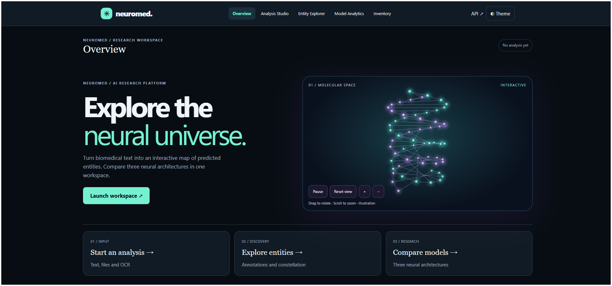
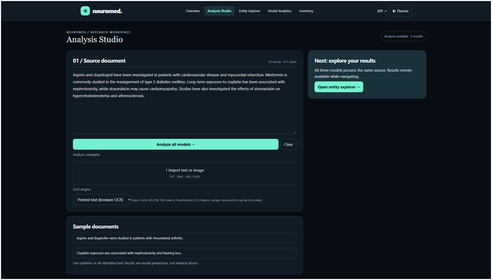
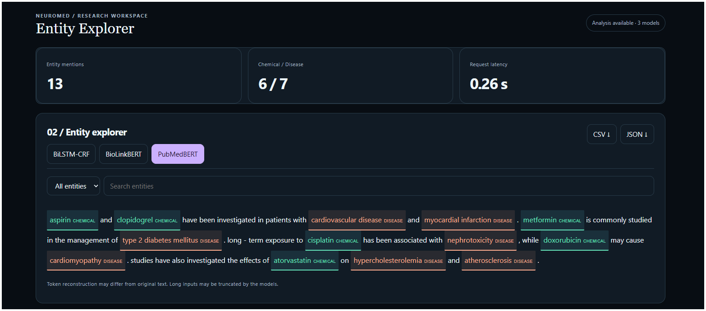
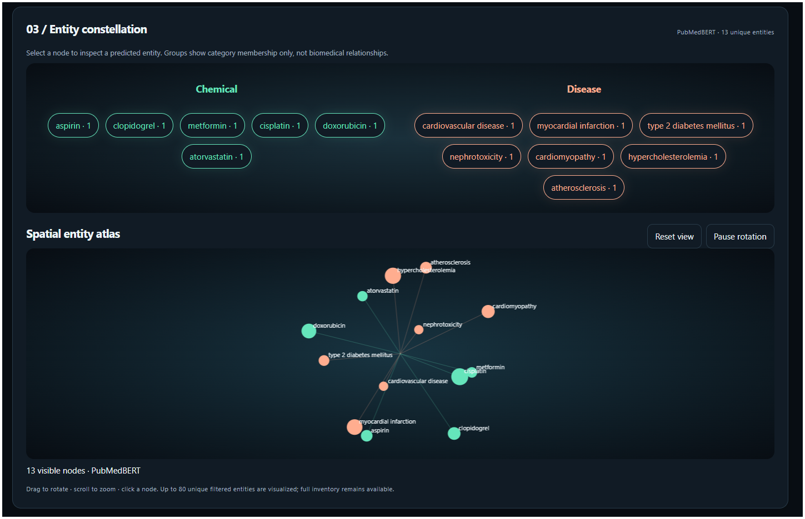
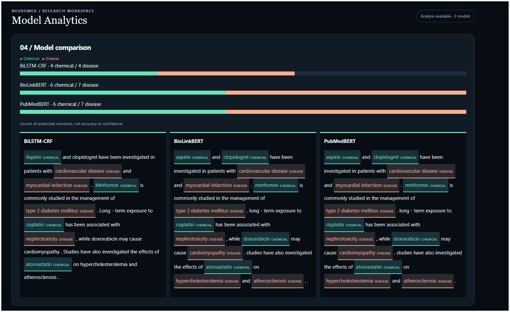
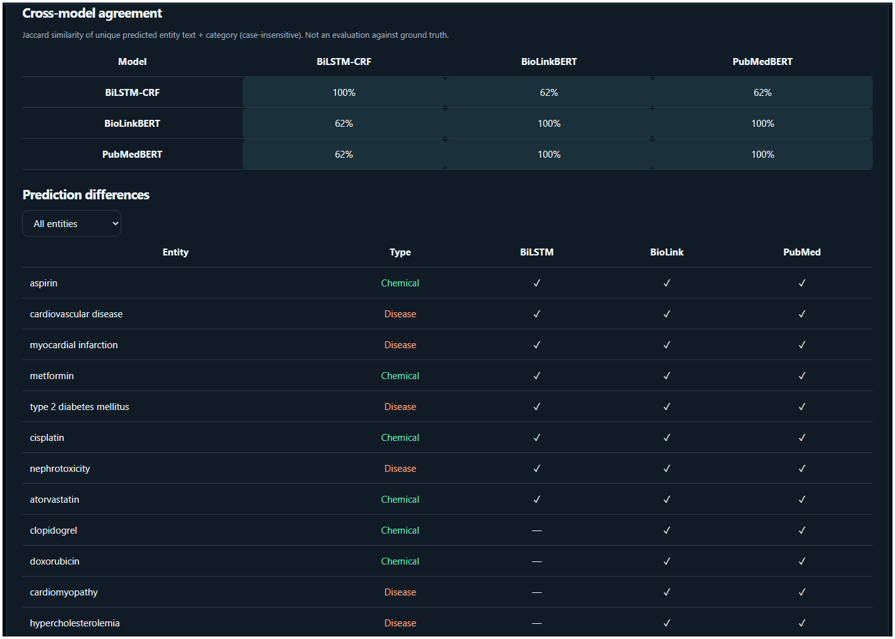
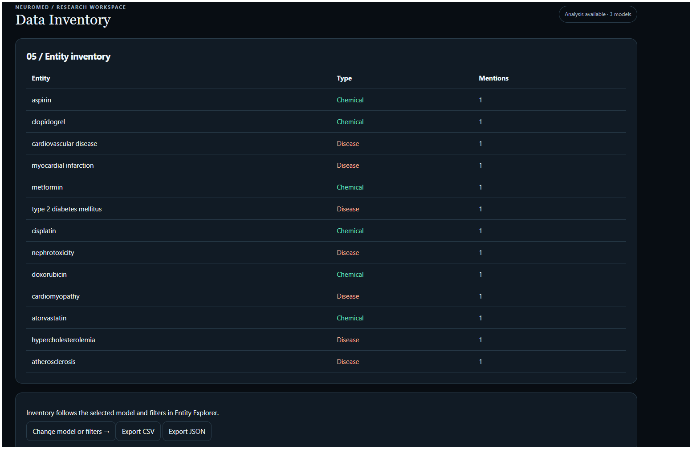
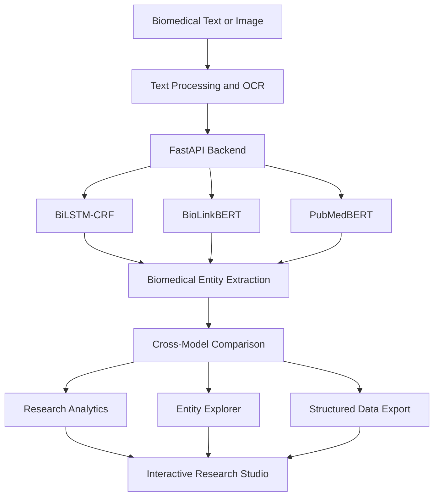

# 🧬 NeuroMed AI — Ultimate Research Studio

**An interactive biomedical intelligence platform powered by Deep Learning, Natural Language Processing and Biomedical Transformers.**


---


## 🚀 Live Demo

**[Launch NeuroMed AI — Live Research Studio](https://neuromed-ai-sigma.vercel.app)**

The application is deployed on Vercel (Hobby plan). All three inference models and printed/handwritten OCR were reported working in post-deployment tests. Use synthetic or public example text only; do not upload confidential patient data.

## 🌐 Project Overview

NeuroMed AI is an end-to-end biomedical Natural Language Processing platform designed to extract, analyze, visualize and compare biomedical entities from unstructured text.

The platform integrates three trained deep learning architectures within an interactive research environment, bridging biomedical NLP, experimental research, data visualization and modern software engineering.

The repository includes the complete application source code, trained model artifacts, datasets, experimental notebooks and evaluation results.

## 📸 Application Preview

### 1. Research Studio Overview

The interactive landing page introduces the biomedical NLP workspace and its molecular-inspired visualization.



### 2. Biomedical Text Analysis

Enter biomedical text or import a document, then run all three integrated models on the same source.



### 3. Named Entity Recognition

Explore color-coded chemical and disease predictions, switch between models, filter entities and export results.



### 4. Interactive Spatial Entity Atlas

Explore predicted entities through an interactive spatial visualization. Groups indicate category membership, not verified biomedical relationships.



### 5. Neural Model Comparison

Compare predicted entity counts and annotated text side by side.



| Model | Chemical mentions | Disease mentions | Total |
|---|---:|---:|---:|
| BiLSTM-CRF | 4 | 4 | 8 |
| BioLinkBERT | 6 | 7 | 13 |
| PubMedBERT | 6 | 7 | 13 |

### 6. Cross-Model Agreement

The agreement matrix uses Jaccard similarity over unique predicted entity text and category pairs. For this demonstration, BioLinkBERT and PubMedBERT agree on 100% of their predicted entities, while BiLSTM-CRF shares approximately 62% agreement with each Transformer model.



These figures describe a single demonstration, not benchmark accuracy or clinical validity.

### 7. Biomedical Entity Inventory

Inspect structured entity names, categories and mention counts, with CSV and JSON export options.



All screenshots illustrate application behavior using example biomedical text rather than patient records.

## 📊 Project at a Glance

| Component | Description |
|---|---|
| Project Status | Completed |
| Research Domain | Biomedical NLP |
| Core Task | Named Entity Recognition |
| Integrated Models | 3 trained architectures |
| Experimental Models | BiLSTM-CRF, BioLinkBERT, PubMedBERT and Mistral-7B |
| Dataset | BC5CDR |
| Entity Categories | Chemicals and Diseases |
| Backend | FastAPI |
| Frontend | Interactive Research Studio |
| Model Distribution | Git LFS |
| Evaluation Results | CSV and JSON |
| Application Availability | Live on Vercel and local execution |

## 🎯 Research Objectives

- Extract chemical and disease entities from biomedical documents.

- Investigate recurrent and Transformer-based neural architectures.

- Compare model predictions and experimental performance.

- Explore cross-model agreement and entity distributions.

- Transform unstructured biomedical text into structured information.

- Integrate trained NLP models into a functional research application.

- Support experimental reproducibility through datasets, notebooks and evaluation results.

## ✨ Key Features

| Feature | Description |
|---|---|
| Biomedical NER | Automatic chemical and disease entity extraction |
| Multi-model Analysis | Simultaneous analysis using three trained architectures |
| Interactive 3D Visualizations | Rotatable and zoomable scientific illustrations |
| Spatial Entity Atlas | Interactive exploration of detected biomedical entities |
| Agreement Matrix | Cross-model comparison using Jaccard similarity |
| OCR Integration | Printed and handwritten text extraction |
| Research Analytics | Dynamic charts and entity distributions |
| Entity Inventory | Searchable and filterable biomedical entity tables |
| Data Export | Structured CSV and JSON export |
| Adaptive Interface | Responsive light and dark themes |
| Experimental Resources | Training notebooks, datasets and evaluation results |

## 🧠 Deep Learning Architectures

### 1. BiLSTM-CRF

A recurrent neural architecture combining:

- Word embeddings.

- Bidirectional Long Short-Term Memory networks.

- Conditional Random Fields.

- Structured BIO sequence labeling.

- Viterbi decoding.

This architecture captures sequential context and dependencies between predicted entity labels.

### 2. BioLinkBERT

A biomedical Transformer architecture adapted to named entity recognition.

- Contextual token representations.

- Biomedical domain knowledge.

- Transformer-based token classification.

- Chemical and disease entity recognition.

### 3. PubMedBERT

A domain-specific Transformer pretrained on biomedical literature.

- Biomedical contextual representations.

- Domain-specific vocabulary.

- Fine-tuning for biomedical NER.

- Context-aware entity classification.

### 4. Mistral-7B — Experimental Evaluation

Mistral-7B is included in the experimental comparison to investigate the capabilities of large language models for biomedical entity extraction.

Its evaluation results are provided alongside the other architectures.

The interactive inference application integrates BiLSTM-CRF, BioLinkBERT and PubMedBERT.

## 📚 Dataset — BC5CDR

The project uses the BioCreative V Chemical Disease Relation dataset for biomedical named entity recognition.

The repository contains raw, cleaned and BIO-formatted dataset resources.

### Dataset Organization

- Training dataset.

- Validation dataset.

- Testing dataset.

- Cleaned biomedical text.

- BIO-formatted annotations.

### BIO Labeling Scheme

| Label | Meaning |
|---|---|
| B-Chemical | Beginning of a chemical entity |
| I-Chemical | Continuation of a chemical entity |
| B-Disease | Beginning of a disease entity |
| I-Disease | Continuation of a disease entity |
| O | Outside an entity |

## ⚙️ System Architecture



## 🔬 Interactive Research Workspace

### Overview

An interactive introduction to biomedical intelligence and the research platform.

### Analysis Studio

Biomedical text input, OCR processing and multi-model inference.

### Entity Explorer

Interactive biomedical annotations and spatial entity exploration.

### Model Analytics

Comparative analysis of neural predictions, entity distributions and model agreement.

### Data Inventory

Structured entity management, filtering, searching and data export.

## 📈 Experimental Evaluation

The repository includes experimental results for the following models:

| Model | CSV Results | JSON Results | Application Integration |
|---|---|---|---|
| BiLSTM-CRF | Available | Available | Yes |
| BioLinkBERT | Available | Available | Yes |
| PubMedBERT | Available | Available | Yes |
| Mistral-7B | Available | Available | Experimental |

The evaluation resources are available in:

- `results  accuracy/RESULTS AS CSV/`

- `results  accuracy/RESULTS AS JSON/`

The experimental notebooks provide additional resources for understanding the training and comparison workflows.

## ⚡ Model Optimization & Cloud Deployment

The production backend uses dynamically quantized INT8 ONNX versions of BioLinkBERT and PubMedBERT, while retaining the PyTorch BiLSTM-CRF and OCR pipeline.

| Model | FP32 ONNX (MiB) | INT8 ONNX (MiB) |
|---|---:|---:|
| BioLinkBERT | 410.86 | 103.41 |
| PubMedBERT | 415.62 | 104.60 |
| **Total** | **826.48** | **208.01** |

The combined model size decreased by approximately **74.83%**. Local process memory measurements decreased from approximately 2,134 MiB to 497 MiB in the observed tests; these are not cloud memory benchmarks. Token predictions matched on one conversion test sentence, which does not establish benchmark-wide accuracy equivalence.

Production configuration: Python 3.12, FastAPI, ONNX Runtime, Git LFS enabled, and `vercel-deploy` as the Vercel root directory. The Large Functions configuration allowed the build to pass the initial 500 MB bundle limit. Cloud load testing and broader quantization evaluation remain future work.

## 🛠️ Technology Stack

| Layer | Technologies |
|---|---|
| Programming Languages | Python, JavaScript |
| Deep Learning | PyTorch |
| Optimized Inference | ONNX Runtime, INT8 quantization |
| Cloud Deployment | Vercel |
| Neural Architectures | BiLSTM, CRF, Transformers |
| Natural Language Processing | Hugging Face Transformers |
| Backend | FastAPI, Uvicorn |
| Frontend | HTML5, CSS3, JavaScript |
| Data Processing | Pandas, NumPy |
| Visualization | Canvas, SVG, 3D Projections |
| OCR | Tesseract.js, Microsoft TrOCR |
| Experimentation | Jupyter Notebook |
| Version Control | Git, GitHub |
| Large File Management | Git LFS |

## 📂 Project Structure

```text
neuromed-ai/
│
├── Dataset/
│   ├── BIO-DATA/
│   │   ├── train_bio_horizontal.csv
│   │   ├── val_bio_horizontal.csv
│   │   └── test_bio_horizontal.csv
│   │
│   ├── Cleaned Dataset/
│   │   ├── train_clean.csv
│   │   ├── validation_clean.csv
│   │   └── test_clean.csv
│   │
│   └── Raw Dataset/
│       └── bc5cdr_dataset/
│
├── notebooks/
│   ├── 1.BiLSTM_CRF_finale.ipynb
│   ├── 2.BioLinkBERT.ipynb
│   ├── 3.PubMedBERT_finale.ipynb
│   ├── 4.LLM.ipynb
│   ├── 5.comparison.ipynb
│   └── 6.gemini-model.py
│
├── results  accuracy/
│   ├── RESULTS AS CSV/
│   │   ├── BiLSTM-CRF.csv
│   │   ├── BioLinkBERT.csv
│   │   ├── PubMedBERT.csv
│   │   └── Mistral-7B.csv
│   │
│   └── RESULTS AS JSON/
│       ├── BiLSTM-CRF.json
│       ├── BioLinkBERT.json
│       ├── PubMedBERT.json
│       └── Mistral-7B.json
│
├── screenshots/
│   ├── overview.png
│   ├── analysis-studio.png
│   ├── entity-explorer.png
│   ├── entity-atlas.png
│   ├── model-comparison.png
│   ├── agreement-matrix.png
│   └── inventory.png
│
├── UI INTERFACE/
│   ├── app.py
│   ├── index.html
│   ├── biolinkbert_model.pkl
│   ├── pubmedbert_model.pkl
│   ├── model.pth
│   ├── word2idx.pkl
│   ├── tag2idx.pkl
│   └── idx2tag.pkl
│
├── vercel-deploy/
│   ├── app.py
│   ├── index.html
│   ├── requirements.txt
│   ├── .python-version
│   ├── model.pth
│   ├── word2idx.pkl
│   ├── tag2idx.pkl
│   ├── idx2tag.pkl
│   └── onnx_models/
│       ├── biolinkbert_int8.onnx
│       ├── pubmedbert_int8.onnx
│       ├── biolinkbert_tokenizer/
│       └── pubmedbert_tokenizer/
│
├── .gitattributes
├── .gitignore
├── README.md
└── TABOUCHI + LATRACH KACEM.txt
```

## 📦 Trained Model Availability

All model artifacts required by the three integrated inference architectures are included in the repository.

Large files are managed using Git Large File Storage (Git LFS).

| Artifact | Availability |
|---|---|
| biolinkbert_model.pkl | Available |
| pubmedbert_model.pkl | Available |
| model.pth | Available |
| word2idx.pkl | Available |
| tag2idx.pkl | Available |
| idx2tag.pkl | Available |

The initial publication successfully transferred approximately 883 MB of Git LFS objects, including model and dataset resources.

## 🚀 Installation and Getting Started

For the optimized production version, clone the repository with Git LFS, create and activate a Python 3.12 virtual environment as described below, then run:

```bash
cd vercel-deploy
python -m pip install -r requirements.txt
python app.py
```

Open http://127.0.0.1:8001. The following steps also document the original research version.

### Prerequisites

- Python.

- Git.

- Git LFS.

- Sufficient memory and disk space for the trained models.

- Internet access for downloading the repository and additional pretrained resources.

### 1. Configure Git LFS

```bash
git lfs install
```

### 2. Clone the Repository

```bash
git clone https://github.com/ABDELARAHMENE-TABOUCHI/neuromed-ai.git
cd neuromed-ai
git lfs pull
```

### 3. Create a Virtual Environment

```bash
python -m venv .venv
```

Activate the environment on Windows:

```powershell
.\.venv\Scripts\Activate.ps1
```

On Linux or macOS:

```bash
source .venv/bin/activate
```

### 4. Install Dependencies

Install the core application dependencies:

```bash
pip install torch transformers fastapi uvicorn numpy pandas pillow python-multipart
```

Additional dependencies or specific package versions may be required depending on the original training environment and serialized model artifacts.

### 5. Launch NeuroMed AI

```bash
cd "UI INTERFACE"
python app.py
```

Alternatively, start the FastAPI server using:

```bash
uvicorn app:app --host 127.0.0.1 --port 8000
```

### 6. Access the Application

| Service | URL |
|---|---|
| NeuroMed AI Research Studio | http://127.0.0.1:8000 |
| Interactive API Documentation | http://127.0.0.1:8000/docs |
| Alternative API Documentation | http://127.0.0.1:8000/redoc |

## 🔌 API Endpoints

| Method | Endpoint | Description |
|---|---|---|
| GET | / | Research Studio interface |
| POST | /predict | Biomedical entity extraction |
| POST | /ocr | Optical character recognition |
| GET | /docs | Interactive API documentation |

## 🔁 Research Reproducibility

The repository provides the resources necessary to explore the experimental workflow:

- Raw and preprocessed biomedical datasets.

- BIO sequence-labeling resources.

- Model training notebooks.

- Trained neural model artifacts.

- Comparative evaluation notebooks.

- Experimental results in CSV and JSON formats.

- Integrated inference backend.

- Interactive research frontend.

Exact reproduction of training results may depend on package versions, hardware, random seeds and training configurations.

## ✅ Project Completion

- [x] Biomedical dataset preprocessing.

- [x] BIO sequence labeling.

- [x] BiLSTM-CRF implementation and training.

- [x] BioLinkBERT fine-tuning.

- [x] PubMedBERT fine-tuning.

- [x] LLM experimental evaluation.

- [x] Comparative model analysis.

- [x] FastAPI backend development.

- [x] Interactive research interface.

- [x] OCR integration.

- [x] Research analytics and visualizations.

- [x] CSV and JSON export.

- [x] Publication of trained model artifacts.

- [x] Publication of datasets and notebooks.

- [x] Complete GitHub repository publication.

- [x] INT8 ONNX conversion of both BERT models.
- [x] Vercel production deployment.
- [x] Post-deployment functional testing.

## 🔮 Future Perspectives

The core project is completed. Potential research extensions include:

- Cloud performance and load testing.

- Biomedical relation extraction.

- Additional biomedical entity categories.

- Advanced document processing.

- Multilingual biomedical NLP.

- Further model compression and inference optimization.

- Expanded experimental benchmarking.

## ⚠️ Research Disclaimer

The public demo is not intended for confidential medical records or personal health information.

NeuroMed AI is an educational and research-oriented platform.

Its predictions are not clinically validated and must not be used for medical diagnosis, treatment recommendations or clinical decision-making.

Architecture visualizations are educational representations. Cross-model agreement does not establish prediction accuracy or medically validated relationships.

Only load trusted serialized model artifacts. Dataset and pretrained model usage remains subject to their respective original licenses and distribution terms.

## 👨‍💻 Author

**Abdelrahmene Tabouchi**

AI & Data Science Engineering Student

Badji Mokhtar University — Annaba, Algeria

[GitHub Profile](https://github.com/ABDELARAHMENE-TABOUCHI)

---

<div align="center">

### 🧬 NeuroMed AI — Ultimate Research Studio

**From Biomedical Language to Structured Intelligence.**

Deep Learning · Biomedical NLP · Artificial Intelligence · Research

⭐ If you find this project interesting, consider starring the repository.

</div>
